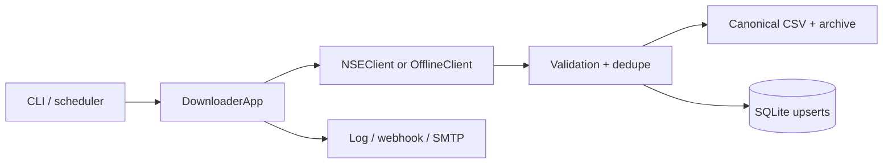

# Architecture

The configuration layer owns source URLs and data contracts. The application coordinates acquisition independently per dataset, validation rejects unusable responses, and only validated data reaches CSV or SQLite.
